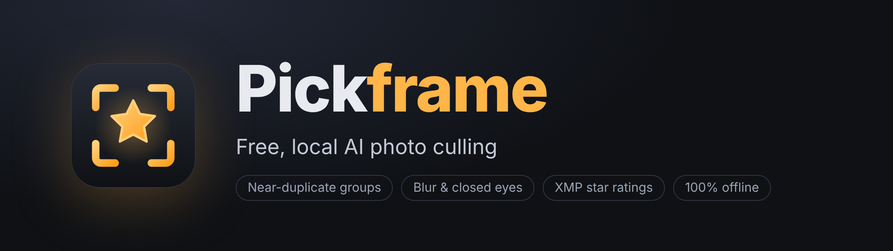
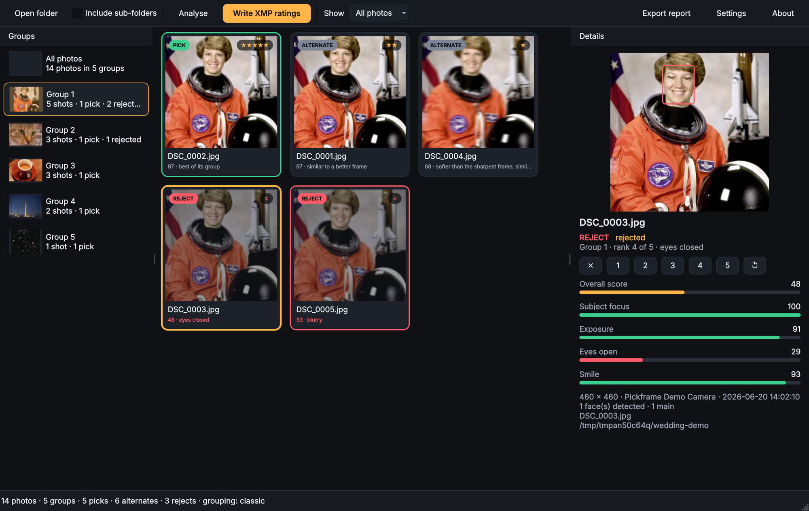
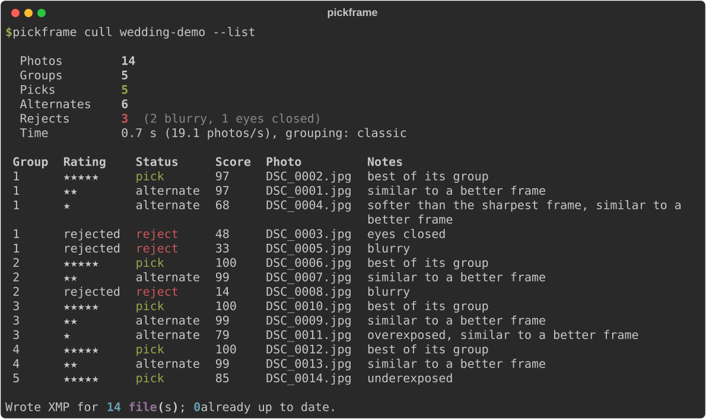
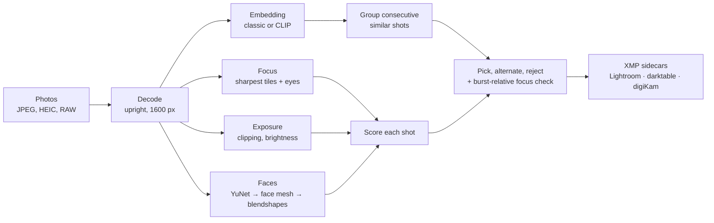
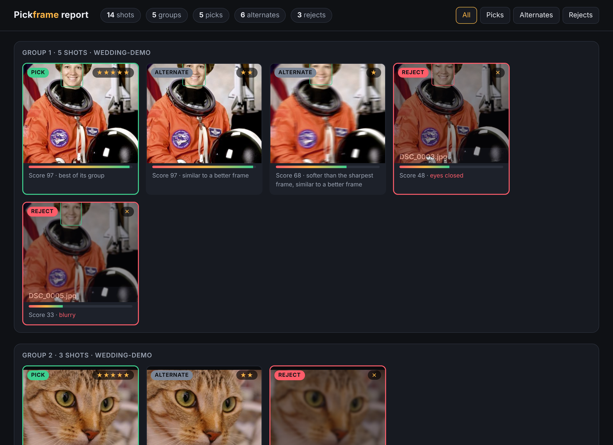

<p align="center">
  
</p>

<p align="center">
  <a href="https://github.com/lobojoel2003/Pickframe/actions/workflows/ci.yml"></a>
  <a href="https://github.com/lobojoel2003/Pickframe/releases/latest"></a>
  <a href="https://github.com/lobojoel2003/Pickframe/releases"></a>
  
  
  <a href="LICENSE"></a>
</p>

**Pickframe** is a free desktop app that culls your photo shoots for you, entirely on your own
computer. It groups near-duplicate shots, flags blurry frames and closed eyes, scores faces, picks
the best frame of every burst, and writes star ratings that **Lightroom, darktable and digiKam**
read straight away. No account, no subscription, no uploads.

<p align="center">
  
</p>

## Why Pickframe?

Photographers spend hours picking the best few hundred frames out of thousands. AI culling tools
save that time, but they are subscription-only:

| Tool | Culling price |
| --- | --- |
| Aftershoot | from $10/month for culling, $45/month for the bundle |
| Narrative | $10 to $60/month |
| Imagen | culling add-on from $12/month |

*Prices from [Narrative's 2026 comparison of Aftershoot alternatives](https://narrative.so/blog/best-aftershoot-alternatives-2026),
which lists no open source option.*

Pickframe is that open source option: GPL-licensed, offline, and it hands its decisions to the
editor you already use instead of locking them in its own catalogue.

## Features

- **Groups near-duplicates**: bursts, brackets and repeated poses, using capture time plus image
  similarity (a fast built-in descriptor, or the CLIP neural network for smarter grouping).
- **Flags blur** that matters: it measures the sharpest parts of the frame and the eyes, so shallow
  depth of field is fine but camera shake and missed focus are caught. Inside a burst, every frame is
  compared with the sharpest one.
- **Detects closed eyes** with a 478-point face mesh and expression model, and scores faces on eyes
  open, eye focus, smile and whether they face the camera.
- **Checks exposure** for blown highlights and crushed shadows.
- **Picks the best frame** of each group and writes **XMP sidecars**: star ratings, rejects, and the
  pick/reject flags of Lightroom Classic 13.2+ and digiKam. Your existing metadata, edits and keywords
  are kept, ratings you set by hand are never overwritten, and `pickframe reset` undoes everything.
- **RAW + JPEG** pairs count as one shot. Raw files from Canon, Nikon, Sony, Fujifilm, Olympus,
  Panasonic, Pentax, Leica, Hasselblad and others are read through their embedded previews; HEIC/HEIF
  and AVIF work too.
- **Desktop app and command line**, an HTML/CSV/JSON report, and a cache that makes re-runs instant.
- **Private by design**: the face models (3.6 MB) are bundled, and nothing ever leaves your computer.

## Download

Get the latest version from the **[Releases page](https://github.com/lobojoel2003/Pickframe/releases/latest)**:

| Platform | Download | Notes |
| --- | --- | --- |
| Windows 10/11 | `Pickframe-<version>-windows-x64-setup.exe` | Installer. A portable `.zip` is also available. |
| macOS 14+ (Apple silicon) | `Pickframe-<version>-macos-arm64.dmg` | Not notarised yet: right-click the app and choose **Open** the first time. |
| Linux x86_64 | `Pickframe-<version>-linux-x86_64.AppImage` | `chmod +x` and run. Needs glibc 2.39+ (Ubuntu 24.04, Fedora 40, Debian 13 or newer). A `.tar.gz` is also available. |
| Any OS with Python 3.10+ | `pickframe-<version>-py3-none-any.whl` | See [Install with pip](#install-with-pip). |

Every release lists SHA-256 checksums in `SHA256SUMS.txt`.

### Install with pip

```bash
pip install "pickframe[all] @ git+https://github.com/lobojoel2003/Pickframe.git"
```

`[all]` adds the desktop app (PySide6), full raw support (rawpy) and HEIC/AVIF (pillow-heif). Without
extras you get the command-line tool, which still reads JPEG, PNG, TIFF, WebP and raw previews. You
can also `pip install` the wheel attached to a release.

## Quick start

### Desktop app

1. Open **Pickframe** and drop a folder of photos onto the window (or click **Open folder**).
2. Pickframe analyses the photos (about 8 full-resolution 24 MP JPEGs a second on a 4-core CPU, so a
   2,000-photo wedding takes roughly four minutes) and shows them grouped, best frame first. Green is a pick, grey an alternate, red a reject, with the reason underneath.
3. Change anything you disagree with: `1` to `5` set stars, `X` rejects, `0` clears, `U` goes back to
   Pickframe's choice. Arrow keys move between photos.
4. Click **Write XMP ratings**, then open the folder in your photo editor.

**Settings** adjusts the blur and closed-eye sensitivity, the number of picks per group, how rejects
are written, and downloads the optional CLIP model.

### Command line

```bash
# Preview what Pickframe would do, with an HTML report
pickframe cull ~/Pictures/2026-06-20-wedding --dry-run --list --report report.html

# Write the ratings (sidecars next to the photos)
pickframe cull ~/Pictures/2026-06-20-wedding

# Undo everything Pickframe wrote
pickframe reset ~/Pictures/2026-06-20-wedding
```

<p align="center">
  
</p>

The release downloads include the same tool as `pickframe-cli` (Windows and Linux folders,
`Pickframe.app/Contents/MacOS/pickframe-cli` on macOS, `Pickframe.AppImage cli ...` on Linux).

## What gets written

For every photo Pickframe writes an XMP sidecar next to it. Raw files get both common names, so every
app finds one:

| File | Read by |
| --- | --- |
| `IMG_0001.CR3.xmp` | darktable, digiKam (default naming), and most open source tools |
| `IMG_0001.xmp` (raw files only) | Lightroom Classic, Camera Raw, Bridge, Capture One |

| Pickframe verdict | `xmp:Rating` | Flags |
| --- | --- | --- |
| **Pick** (best of its group) | 3 to 5 stars by quality | Lightroom pick (`xmpDM:pick=1`), digiKam *Accepted* |
| **Alternate**, close to the pick | 2 stars | none |
| **Alternate**, clearly weaker | 1 star | none |
| **Reject** (blurry, eyes closed, unreadable) | `-1` (rejected), or 1 star / unrated with `--reject-as` | Lightroom reject (`xmpDM:pick=-1`), digiKam *Rejected* |

Pickframe also stores its score, group number and reasons under its own `pickframe:` namespace, so a
later run knows which ratings it wrote. Use `--label Green` to add a colour label to picks.

### Reading the ratings in your editor

- **darktable**: import the folder; for images that are already imported, enable *look for updated
  XMP files on startup* in the preferences, or re-import.
- **digiKam**: new folders pick up sidecars automatically; for existing ones use *Item → Reread
  Metadata From Files*.
- **Lightroom Classic**: import the folder, or select already-imported photos and choose *Metadata →
  Read Metadata from Files*. Lightroom ignores sidecars for JPEG files, so for JPEG shoots add
  `--embed-jpeg` (or tick the option in Settings) to write the rating inside the JPEG.
- **Capture One / Bridge / Photo Mechanic**: read `xmp:Rating` from the sidecars.

## How it works



| Step | Method |
| --- | --- |
| Focus | Variance of the Laplacian in the sharpest 10% of tiles, so bokeh does not count against a photo. With faces, focus around the eyes weighs most. Inside a group, frames with far less fine detail than the sharpest frame (normalised for exposure) are marked soft or blurry. |
| Faces | [YuNet](https://github.com/opencv/opencv_zoo/tree/main/models/face_detection_yunet) finds faces; the [MediaPipe Face Landmarker](https://ai.google.dev/edge/mediapipe/solutions/vision/face_landmarker) mesh confirms them and places 478 landmarks; its blendshape model scores blinks and smiles. Closed eyes combine eyelid geometry with the blink score, with a stricter threshold for small faces. |
| Similarity | Built-in: blurred thumbnail + low-frequency DCT + colour histogram. Optional: [CLIP ViT-B/32](https://github.com/openai/CLIP) image embeddings (`pickframe models download clip`, 88 MB, once). |
| Grouping | Photos in each folder are walked in capture order; a frame joins the current group when it resembles one of the last three frames and was taken within 60 seconds. |
| Runtime | Everything runs on [ONNX Runtime](https://onnxruntime.ai) and OpenCV, on the CPU, with one thread per core. |

The bundled models were converted from their original formats by [`tools/build_models.py`](tools/build_models.py)
and checked against the original TFLite interpreter (largest difference 6e-4 pixels). Licences are in
[`src/pickframe/models/NOTICE.md`](src/pickframe/models/NOTICE.md).

## Reports

`--report report.html` (or **Export report** in the app) writes a single self-contained page with
every group, the decision and the reason for each photo, and face boxes (red when the eyes are
closed). CSV and JSON exports are available for spreadsheets and scripts.

<p align="center">
  
</p>

## Command reference

| Command | What it does |
| --- | --- |
| `pickframe cull PATH...` | Analyse photos and write XMP. `-r` includes sub-folders, `-n/--dry-run` writes nothing, `-l/--list` prints every photo, `--report FILE` writes `.html`, `.csv` or `.json`. |
| `pickframe reset PATH...` | Remove everything Pickframe wrote and restore earlier ratings. |
| `pickframe info FILE...` | Show the measurements for single photos (`--json` for scripts). |
| `pickframe models list` / `download clip` / `remove clip` | Manage the optional CLIP model. |
| `pickframe cache clear` | Forget cached analyses. |
| `pickframe gui [FOLDER]` | Open the desktop app. |
| `pickframe --version` | Version, build number and commit. |

Tuning options for `cull`:

| Option | Default | Meaning |
| --- | --- | --- |
| `--blur 0-1` | 0.30 | Focus score below which a shot is rejected as blurry. Lower it for intentionally soft or low-light work. |
| `--eyes 0-1` | 0.55 | Closed-eye probability that rejects a shot. Raise it if squinting smiles get rejected. |
| `--picks N` | 1 | Picks per group. |
| `--similarity 0-1` | 0.80 classic / 0.88 CLIP | How alike shots must be to share a group. |
| `--max-gap SECONDS` | 60 | Longest pause inside one group. |
| `--embedder auto\|clip\|classic` | auto | `auto` uses CLIP once downloaded. |
| `--reject-as reject\|one-star\|none` | reject | How rejects are written. |
| `--sidecar auto\|darktable\|lightroom` | auto | Sidecar naming. |
| `--embed-jpeg` | off | Also write XMP inside JPEG files (for Lightroom). |
| `--no-flags` | off | Only write star ratings. |
| `--overwrite` | off | Replace ratings you set by hand. |
| `--smile-weight 0-1` | 0.15 | How much smiles count in face scores (0 for serious portraits). |

## Limitations

- Pickframe judges technical quality (focus, eyes, exposure, duplicates). It does not judge
  composition or storytelling; the final call is yours, and every decision can be changed.
- Blur and blink detection use calibrated measurements, not a model trained on your photos. Check the
  rejects of a first shoot and adjust `--blur` / `--eyes` to taste.
- Raw files are analysed through their embedded JPEG preview, which is what your camera showed you.
- The macOS build is ad-hoc signed but not notarised, and there is no Intel macOS build yet (use pip).

## Development

```bash
git clone https://github.com/lobojoel2003/Pickframe.git && cd Pickframe
python -m venv .venv && source .venv/bin/activate
pip install -e ".[dev]"
pytest && ruff check src tests tools && mypy
python tools/make_demo.py demo-shoot && pickframe gui demo-shoot
```

See [CONTRIBUTING.md](CONTRIBUTING.md) for the project layout, and [docs/RELEASING.md](docs/RELEASING.md)
for versioning, build numbers and the release pipeline. Every tag `vX.Y.Z` builds and publishes the
Windows, macOS and Linux apps automatically.

## Credits

- Face detection: [YuNet](https://github.com/opencv/opencv_zoo/tree/main/models/face_detection_yunet) by Shiqi Yu et al. (MIT).
- Face mesh and blendshapes: [MediaPipe](https://github.com/google-ai-edge/mediapipe) by Google (Apache-2.0).
- Optional similarity model: [CLIP](https://github.com/openai/CLIP) by OpenAI (MIT), ONNX export by [Xenova](https://huggingface.co/Xenova/clip-vit-base-patch32).
- Demo photos in the screenshots: Eileen Collins (NASA, public domain), Chelsea the cat (Stefan van der Walt, CC0), coffee (Rachel Michetti, CC0), DSCOVR launch (SpaceX, public domain) and the Hubble eXtreme Deep Field (NASA, public domain), via [scikit-image](https://scikit-image.org). The blink and blur in the demo are simulated by [`tools/make_demo.py`](tools/make_demo.py).

## License

Pickframe is free software under the [GNU General Public License v3.0 or later](LICENSE).
